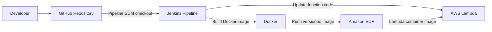
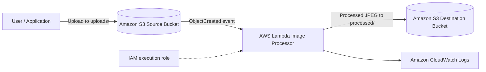
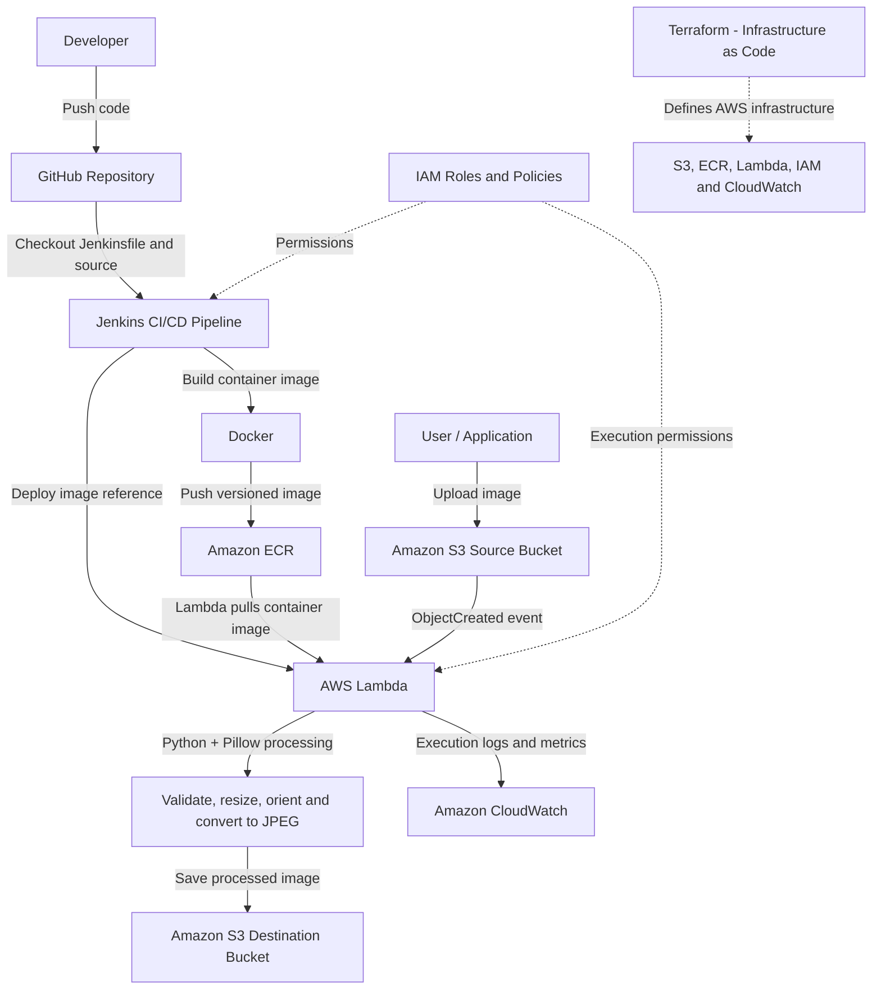

# Automated Image Processing System


A serverless, event-driven image processing application with an automated Jenkins CI/CD pipeline. Images uploaded to Amazon S3 are processed by an AWS Lambda container using Python and Pillow, then saved to a separate S3 destination bucket.

## Architecture

### CI/CD deployment flow



### Runtime image-processing flow



The source and destination buckets are separate to prevent recursive S3-triggered Lambda invocations.

## Complete Architecture Flow

The project has two connected workflows: CI/CD deployment and runtime image processing.

### End-to-end flow



### Flow summary

1. 👨‍💻 **Developer → GitHub** — Pushes application code and the `Jenkinsfile`.
2. 🔄 **GitHub → Jenkins** — Jenkins checks out the repository and starts the pipeline.
3. 🐳 **Jenkins → Docker → Amazon ECR** — Builds and pushes a version-tagged Lambda image.
4. 🚀 **Jenkins → AWS Lambda** — Deploys the latest container image to the Lambda function.
5. 📤 **S3 Source Bucket** — Receives uploaded images in the `uploads/` prefix.
6. ⚡ **S3 Event → Lambda** — An `ObjectCreated` event triggers image processing.
7. 🖼️ **Python + Pillow** — Validates, rotates, resizes, handles transparency, and converts images to JPEG.
8. 📥 **S3 Destination Bucket** — Stores processed JPEG files in the `processed/` prefix.
9. 🔐 **AWS IAM** — Controls deployment and Lambda execution permissions.
10. 📊 **Amazon CloudWatch** — Collects Lambda logs for monitoring and troubleshooting.
11. 🏗️ **Terraform** — Defines AWS infrastructure as code.

**Note:** Terraform configuration is included in this repository. The verified Build #8 CI/CD run used Jenkins, Docker, ECR, and Lambda for deployment; do not interpret the diagram as proof that Terraform provisioned the currently running resources.

## Image Processing

- Accepts JPEG, PNG, and WEBP images.
- Corrects image orientation using EXIF metadata where available.
- Resizes images while preserving aspect ratio.
- Handles transparency by compositing onto a white background.
- Converts processed output to optimized JPEG.
- Enforces configurable input-size and image-pixel limits.
- Writes processed images to the destination bucket under `processed/`.

## CI/CD Pipeline

The Jenkins pipeline is defined in `Jenkinsfile` and performs:

1. **Checkout** – retrieves the configured GitHub branch.
2. **Build** – builds the Lambda container for `linux/amd64`.
3. **Registry authentication** – authenticates to Amazon ECR using Jenkins-managed credentials.
4. **Push** – publishes an immutable build-number-tagged image to ECR.
5. **Deploy** – updates the Lambda function to use the new image and waits for the update to complete.
6. **S3 integration test** – uploads a generated PNG test image to the source bucket and polls the destination bucket for the processed JPEG. The build fails if the output is not found within the configured timeout.

Jenkins credential ID: `aws-ecr-credentials`. AWS credentials are stored in Jenkins Credentials and are not committed to this repository.

## AWS Services and Tools

| Service / Tool | Purpose |
|---|---|
| Amazon S3 | Source image uploads and processed image storage |
| AWS Lambda | Event-driven image processing |
| Amazon ECR | Stores the Lambda container image |
| Amazon CloudWatch | Lambda execution logs |
| AWS IAM | Access control for Lambda and deployment |
| Jenkins | CI/CD orchestration and integration testing |
| Docker | Container image build |
| Terraform | Infrastructure as Code configuration |
| GitHub | Source control and pipeline source |

## Repository Structure

```text
.
├── Jenkinsfile
├── lambda/
│   ├── lambda_function.py
│   ├── requirements.txt
│   └── Dockerfile
├── infrastructure/
│   └── terraform/
│       ├── main.tf
│       ├── variables.tf
│       ├── outputs.tf
│       └── .terraform.lock.hcl
├── architecture/
│   └── architecture.md
├── docs/
│   ├── deployment.md
│   ├── deployment-evidence-and-testing.md
│   ├── interview.md
│   └── evidence/
│       └── README.md
├── test-data/
├── .gitignore
└── README.md
```

## Deployment Configuration

- AWS Region: `ap-south-1`
- ECR repository: `automated-image-processing-processor`
- Lambda function: `automated-image-processing-processor`
- Source object prefix: `uploads/`
- Destination object prefix: `processed/`

Bucket names and AWS account-specific values are configured in the deployment environment. Do not commit access keys, secret keys, Terraform state, or real secret variable files.

## Deployment Evidence

- Screenshot checklist and verified Build #8 measurements: [`docs/evidence/README.md`](docs/evidence/README.md).
- Test status and benchmark methodology: [`docs/deployment-evidence-and-testing.md`](docs/deployment-evidence-and-testing.md).

## Verification

Jenkins Build #8 completed successfully with:

- Docker image built and pushed to ECR using build tag `:8`.
- Lambda function update completed with status `Successful`.
- S3 integration test passed.
- Test output created at `processed/ci-test-8-processed.jpg`.
- Output Content-Type verified as `image/jpeg`.

**Validation status:** Deployment and the PNG S3-to-Lambda integration path are verified. JPEG/WEBP functional coverage, invalid/oversized input behavior, and representative performance/load testing remain pending; see [deployment test results](docs/deployment-evidence-and-testing.md).

## Security Notes

- Keep S3 buckets private and block public access.
- Use least-privilege IAM permissions.
- Store deployment credentials in Jenkins Credentials, not source control.
- Keep Terraform state, plan files, and secret variable files out of Git.
- Review Terraform destructive settings before running `apply` or `destroy`.
