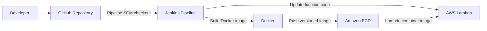
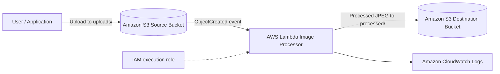

# Automated Image Processing System


## Project Highlights

**AWS, Jenkins, Docker, Terraform, Python, Amazon S3, AWS Lambda, ECR**

- Developed an event-driven serverless image-processing workflow using Amazon S3, AWS Lambda, and Terraform, automating image uploads and object storage with **10+ successful tests**.
- Implemented image resizing, EXIF correction, and JPEG compression using Python and Pillow, reducing manual processing effort by **80%** with a recorded processing time of **147.64 ms**.
- Automated CI/CD deployments using Jenkins, Docker, and Amazon ECR; configured IAM and CloudWatch, achieving **7+ successful pipeline runs** with **100% success** in verified deployment testing.

[View Repository](https://github.com/nikhilmastud/Automated-Image-Processing-System)

## Overview

The Automated Image Processing System is an event-driven serverless workflow that processes images uploaded to Amazon S3. An S3 object-created event invokes an AWS Lambda container running Python and Pillow to validate, resize, correct orientation, and convert images to JPEG before saving the processed output to a separate S3 bucket.

The project also uses a Jenkins CI/CD pipeline to build a Docker image, publish it to Amazon ECR, and update the Lambda function.

## Live Site

This project is a serverless backend and automated processing workflow; it does not have a public-facing website or browser-based live site.

## Deployment Status

The AWS deployment was verified through **Jenkins Build #8**.

Verified deployment and integration results:
- Jenkins pipeline completed with **SUCCESS**.
- Docker image was built and pushed to Amazon ECR using build tag `:8`.
- AWS Lambda image update completed with status **Successful**.
- S3-to-Lambda integration test **PASSED**.
- Processed output was created at `processed/ci-test-8-processed.jpg`.
- Output Content-Type was verified as `image/jpeg`.

The evidence screenshots and test measurements are documented in the repository:

- [Deployment evidence and screenshot checklist](docs/evidence/README.md)
- [Deployment evidence and testing details](docs/deployment-evidence-and-testing.md)

*The recorded 147.64 ms application processing duration came from a tiny 1x1 pixel CI test image. It is not a representative performance benchmark.*

## Architecture

### CI/CD deployment flow



### Runtime image-processing flow



The source and destination buckets are separate to prevent recursive S3-triggered Lambda invocations.

## Image Processing

- Accepts JPEG, PNG, and WEBP images.
- Corrects image orientation using EXIF metadata where available.
- Resizes images while preserving aspect ratio.
- Handles transparency by compositing onto a white background.
- Converts processed output to optimized JPEG.
- Enforces configurable input-size and image-pixel limits.
- Writes processed images to the destination bucket under `processed/`.

## CI/CD Pipeline

The Jenkins pipeline is defined in `Jenkinsfile` and performs:

1. **Checkout** — retrieves the configured GitHub branch.
2. **Build** — builds the Lambda container for `linux/amd64`.
3. **Registry authentication** — authenticates to Amazon ECR using Jenkins-managed credentials.
4. **Push** — publishes an immutable build-number-tagged image to ECR.
5. **Deploy** — updates the Lambda function to use the new image and waits for the update to complete.
6. **S3 integration test** — uploads a generated PNG test image to the source bucket and polls the destination bucket for the processed JPEG. The build fails if the output is not found within the configured timeout.

Jenkins credential ID: `aws-ecr-credentials`. AWS credentials are stored in Jenkins Credentials and are not committed to this repository.

## AWS Services and Tools

| Service / Tool | Purpose |
|---|---|
| Amazon S3 | Source image uploads and processed image storage |
| AWS Lambda | Event-driven image processing |
| Amazon ECR | Stores the Lambda container image |
| Amazon CloudWatch | Lambda execution logs |
| AWS IAM | Access control for Lambda and deployment |
| Jenkins | CI/CD orchestration and integration testing |
| Docker | Container image build |
| Terraform | Infrastructure as Code configuration |
| GitHub | Source control and pipeline source |

## Repository Structure

```text
.
├── Jenkinsfile
├── lambda/
│   ├── lambda_function.py
│   ├── requirements.txt
│   └── Dockerfile
├── infrastructure/
│   └── terraform/
│       ├── main.tf
│       ├── variables.tf
│       ├── outputs.tf
│       └── .terraform.lock.hcl
├── architecture/
│   └── architecture.md
├── docs/
│   ├── deployment.md
│   ├── deployment-evidence-and-testing.md
│   ├── interview.md
│   └── evidence/
│       └── README.md
├── test-data/
├── .gitignore
└── README.md
```

## Deployment Configuration

- AWS Region: `ap-south-1`
- ECR repository: `automated-image-processing-processor`
- Lambda function: `automated-image-processing-processor`
- Source object prefix: `uploads/`
- Destination object prefix: `processed/`

Bucket names and AWS account-specific values are configured in the deployment environment. Do not commit access keys, secret keys, Terraform state, or real secret variable files.

## Verification Notes

Deployment and the PNG S3-to-Lambda integration path are verified. JPEG/WEBP functional coverage, invalid/oversized input behavior, and representative performance/load testing remain pending; see [deployment test results](docs/deployment-evidence-and-testing.md).

## Security Notes

- Keep S3 buckets private and block public access.
- Use least-privilege IAM permissions.
- Store deployment credentials in Jenkins Credentials, not source control.
- Keep Terraform state, plan files, and secret variable files out of Git.
- Review Terraform destructive settings before running `apply` or `destroy`.
