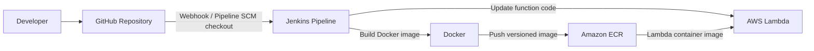
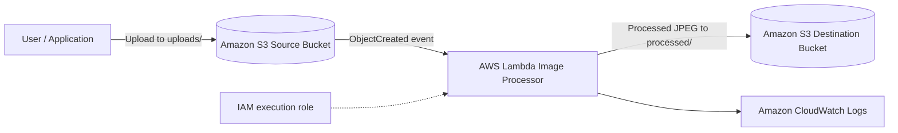

# Automated Image Processing System

A serverless, event-driven image processing application with an automated Jenkins CI/CD pipeline. Images uploaded to Amazon S3 are processed by an AWS Lambda container using Python and Pillow, then saved to a separate S3 destination bucket.

## Architecture

### CI/CD deployment flow



### Runtime image-processing flow



The source and destination buckets are separate to prevent recursive S3-triggered Lambda invocations.

## Image Processing

- Accepts JPEG, PNG, and WEBP images.
- Corrects image orientation where applicable.
- Resizes images while preserving aspect ratio.
- Converts processed output to JPEG.
- Writes processed images to the destination bucket under `processed/`.

## CI/CD Pipeline

The Jenkins pipeline is defined in `Jenkinsfile` and performs:

1. **Checkout** – retrieves the configured GitHub branch.
2. **Build** – builds the Lambda container for `linux/amd64`.
3. **Registry authentication** – authenticates to Amazon ECR using Jenkins-managed credentials.
4. **Push** – publishes a build-number-tagged image to ECR.
5. **Deploy** – updates the Lambda function to use the new image and waits for the update to complete.
6. **S3 integration test** – uploads a generated PNG test image to the source bucket and polls the destination bucket for the processed JPEG. The build fails if the output is not found within the configured timeout.

Jenkins credential ID used by the pipeline: `aws-ecr-credentials`. AWS credentials are stored in Jenkins Credentials and are not committed to this repository.

## AWS Services and Tools

| Service / Tool | Purpose |
|---|---|
| Amazon S3 | Source image uploads and processed image storage |
| AWS Lambda | Event-driven image processing |
| Amazon ECR | Stores the Lambda container image |
| Amazon CloudWatch | Lambda execution logs |
| AWS IAM | Access control for Lambda and deployment |
| Jenkins | CI/CD orchestration and integration testing |
| Docker | Container image build |
| Terraform | Infrastructure as Code foundation |
| GitHub | Source control and pipeline source |

## Repository Structure

```text
.
├── Jenkinsfile
├── lambda/
│   ├── lambda_function.py
│   ├── requirements.txt
│   └── Dockerfile
├── infrastructure/
│   └── terraform/
├── architecture/
│   └── architecture.md
├── docs/
│   ├── deployment.md
│   └── interview.md
├── .gitignore
└── README.md
```

## Deployment Configuration

- AWS Region: `ap-south-1`
- ECR repository: `automated-image-processing-processor`
- Lambda function: `automated-image-processing-processor`
- Source object prefix: `uploads/`
- Destination object prefix: `processed/`

Bucket names and AWS account-specific values are configured in the Jenkinsfile / AWS environment. Do not commit access keys, secret keys, or Terraform state.

## Verification

A successful Jenkins run should show:

- Docker image built and pushed to ECR with the Jenkins build number.
- Lambda function update completed successfully.
- `S3 integration test PASSED.`
- Jenkins build result: `SUCCESS`.

## Security Notes

- Keep S3 buckets private and block public access.
- Use least-privilege IAM permissions.
- Store deployment credentials in Jenkins Credentials, not source control.
- Keep Terraform state and secret variable files out of Git.
