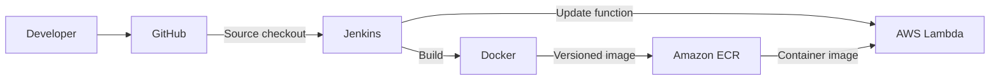
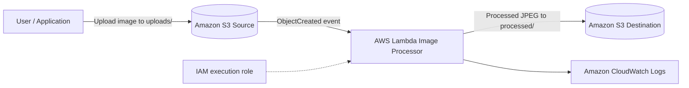

# Architecture

## CI/CD Deployment Flow

## Runtime Image Processing Flow

## Processing Tasks

- Accept JPEG, PNG, and WEBP input images.
- Correct orientation where applicable.
- Resize while preserving aspect ratio.
- Convert output to optimized JPEG.
- Store processed images separately from uploads.

## Runtime Flow

1. An image is uploaded to the source bucket.
2. S3 sends an ObjectCreated event.
3. Lambda reads the image from S3.
4. Pillow processes and converts the image.
5. Lambda writes the output to the destination bucket.
6. CloudWatch records execution logs.

## CI/CD Flow

1. Jenkins checks out the GitHub repository.
2. Docker builds the Lambda-compatible image for `linux/amd64`.
3. Jenkins authenticates to ECR and pushes a build-number-tagged image.
4. Jenkins updates the Lambda function to use that image.
5. Jenkins uploads a generated test image to the source bucket.
6. Jenkins checks the destination bucket for the processed output and fails the build if it does not appear within the timeout.

Separate source and destination buckets prevent recursive S3-to-Lambda invocation.
